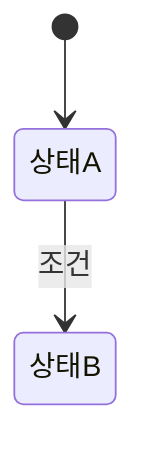

# REA 블루프린트: <대상명>

> 목적: <이해/재구현/개선/연동/장애분석> · 깊이: <L1~L4> · 작성일: <YYYY-MM-DD>
> 근거 등급: [확인] 직접 확인 · [추론] 증거 기반 도출 · [가정] 검증 필요

## 1. 한 문단 요약
<이것은 무엇이고, 무엇을 위해 존재하며, 핵심 메커니즘은 무엇인가>

## 2. 경계 (Context)
| 구분 | 대상 | 방식/형식 | 근거 |
|---|---|---|---|
| 입력 | | | |
| 출력 | | | |
| 외부 연동 | | | |

## 3. 구성도 (Architecture)

| 구성요소 | 책임(1줄) | 근거 |
|---|---|---|

## 4. 데이터 모델 · 상태 전이
- 핵심 엔티티:

## 5. 핵심 흐름 (Sequence)
### 5.1 정상 흐름
### 5.2 대표 예외 흐름

## 6. 설계 의도 · 트레이드오프
| 설계 결정 | 추정 이유(Why) | 포기한 것 | 근거 |
|---|---|---|---|

## 7. 재현 가이드
1. 최소 구성(MVP):
2. 구현 순서:
3. 원본과의 차이(재현물이 있을 때):

## 8. 미확인 사항 · 리스크 · 다음 액션
| 항목 | 현재 등급 | 검증 방법 | 우선순위 |
|---|---|---|---|

## 9. 근거 등급 요약
- 확인 n건 / 추론 n건 / 가정 n건 / 기각 n건
