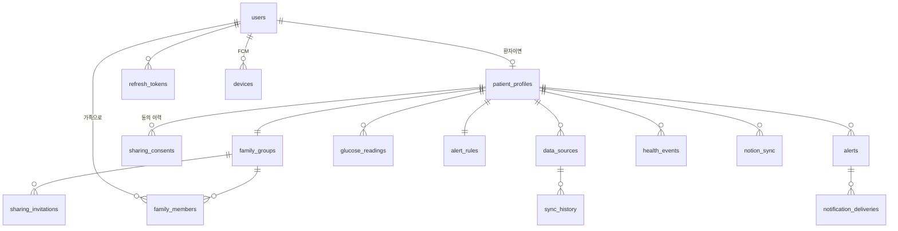

# DB-001 데이터베이스 설계

- 작성 목적: 테이블 구조·인덱스·보관 정책
- 작성 일자: 2026-11-04
- 원본: `backend/src/main/resources/db/migration/V1__init.sql` (Flyway)

## ERD (요약)

## 핵심 제약 (규칙을 DB 가 강제)
| 제약 | 목적 |
|---|---|
| `glucose_readings UNIQUE (patient_id, source, external_id)` | 중복 저장 방지 |
| `CHECK ((flag = 'NORMAL') = (value_mgdl IS NOT NULL))` | LO/HI 는 값 없음 |
| `ix_glucose_patient_measured (patient_id, measured_at DESC)` | 측정 시각 기준 조회 |
| `ux_alerts_active (patient_id, type) WHERE status <> 'RESOLVED'` | 같은 종류 미해소 알림 1개 |
| `ux_users_email (lower(email)) WHERE deleted_at IS NULL` | 탈퇴 후 재가입 허용 |
| `alert_rules CHECK (urgent_low < low < high)` | 잘못된 기준 방지 |

## 측정 시각 · 수신 시각
`measured_at`(센서 측정, UTC), `measured_offset`(원본 오프셋), `received_at`(서버 수신). 미수신·신선도 판단은 `measured_at` 기준.

## 보관 · 삭제
| 데이터 | 보관 | 방식 |
|---|---|---|
| 혈당 원본 | 730일 (`FGC_RETENTION_DAYS`) | 매일 03:15 KST 삭제 |
| 감사 로그·전송 기록 | 365일 | 매일 삭제 |
| refresh 토큰 | 만료·폐기 후 7일 | 매일 삭제 |
| 회원 탈퇴 | 즉시 | 환자 데이터 CASCADE 삭제, 계정 식별정보 제거 |
| 백업 | 14일 | `deploy/backup.sh` (STEP 8 에서 덤프→복원 행 수 일치 확인) |
